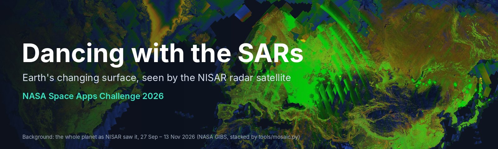
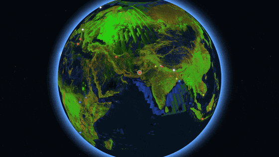
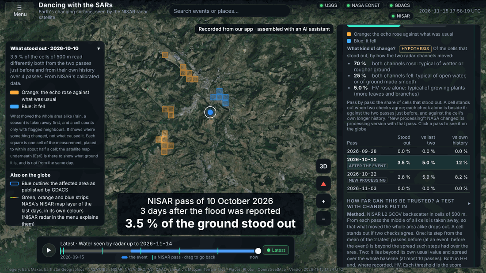
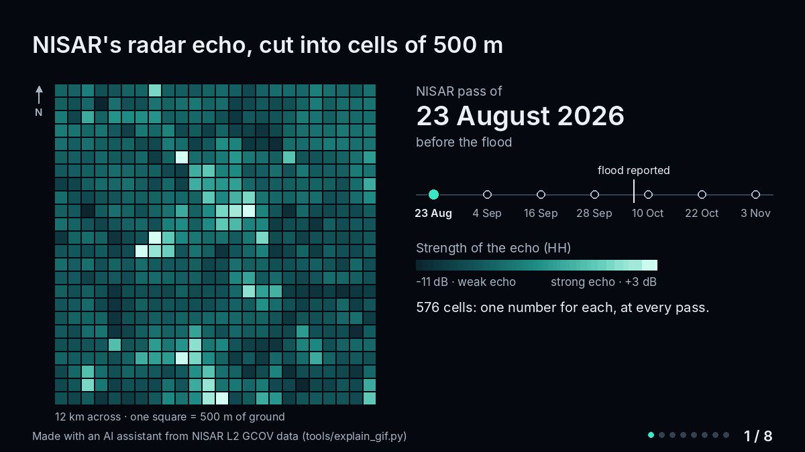
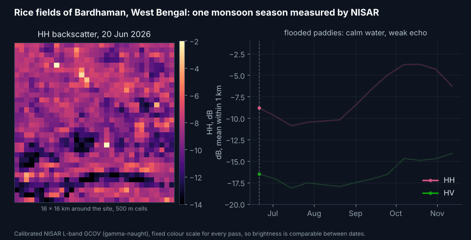
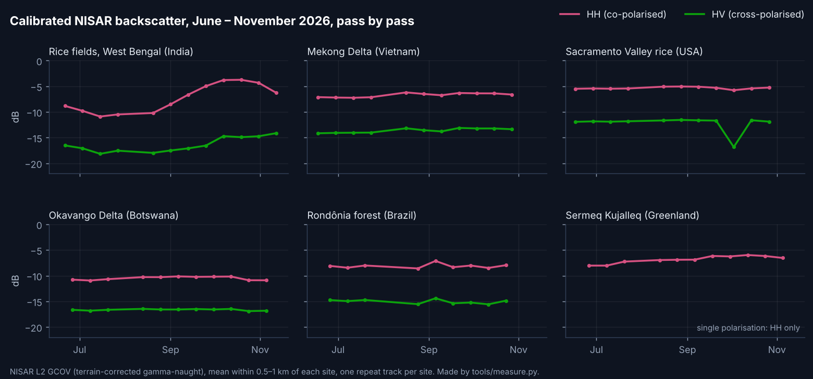
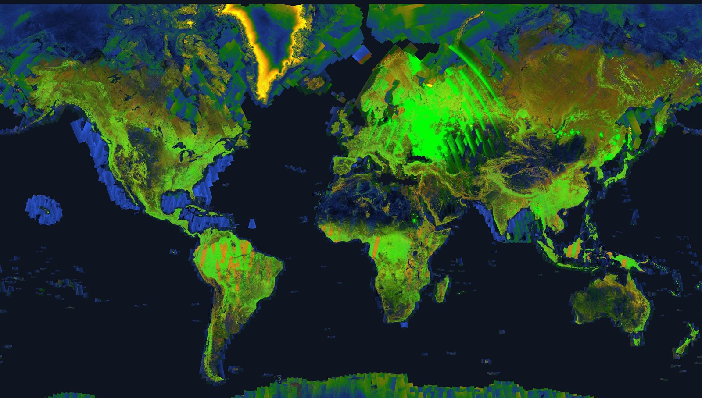
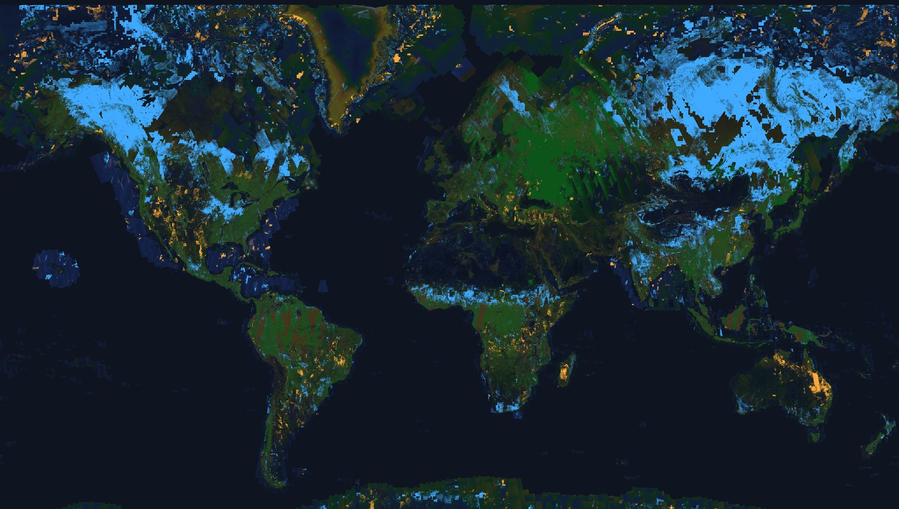
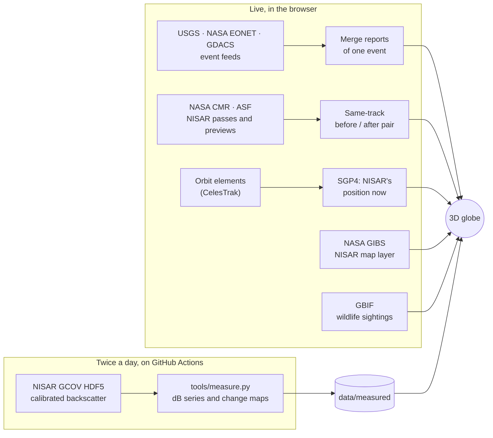

<p align="center">
  
</p>

<p align="center">
  <a href="https://www.spaceappschallenge.org/"></a>
  
  
  
  <a href="LICENSE"></a>
</p>

<h1 align="center">Dancing with the SARs</h1>

<p align="center">
  <b><a href="https://cloudpiercer.space/">Open the live app</a></b>
</p>

<p align="center">
  <b>Earth's surface never holds still.</b><br>
  A live 3D globe that follows the planet's changing surface through the eyes of
  the NASA-ISRO <b>NISAR</b> radar satellite: floods, earthquakes, fires, glaciers
  and harvests, through cloud and at night.<br>
  <b>It shows what a place normally reads on radar, and where the ground did something else.</b>
</p>

<p align="center">
  <br>
  <sub>Recorded from the app: the globe wearing NISAR's own picture of the planet, then the M 5.7 earthquake in Pakistan (17 Oct 2026, USGS).
  The wave fronts are drawn at typical crust speeds, sped up about 6×; they are illustrated, not measured.
  Diamonds mark places measured with calibrated NISAR data.</sub>
</p>

<table>
<tr>
<td width="33%" valign="top">

**🌍 Live events × radar**<br>
Earthquakes, fires, floods and storms from USGS, NASA EONET and GDACS, each
checked against NISAR's passes before and after.

</td>
<td width="33%" valign="top">

**📏 Measured, not guessed**<br>
Calibrated NISAR backscatter in dB, read from the full GCOV products twice
a day by a GitHub job, for places and fresh events.

</td>
<td width="33%" valign="top">

**🛰️ NISAR, live**<br>
The satellite itself orbiting the globe, its 242 km radar swath, the next
pass over any spot, the real star sky and sunlight.

</td>
</tr>
</table>

## What stood out: a flood in Italy

<p align="center">
  
</p>

For 26 places and reported events the app has NISAR's calibrated
backscatter, cut into cells of 500 m. A detector (`tools/detect.py`) says
for every pass which cells stood out. What moved the whole area alike
(rain, a season) is taken away, and then two checks must agree: the cell
differs from the two passes just before, and it differs from its own
longer history, in HH and HV together. At a
flood reported in Tuscany on 7 October 2026 **nothing** stood out on the
pass before it and **3.5 %** of the cells three days after it; 2.8 % a pass
later and nothing after that. In the app, "Show where it stood out" draws
the cells and "Play the passes" runs them through time.

<p align="center">
  
</p>

The detector is measured, not asserted: with a change of known size put
into real passes, a drop of 3 dB over 2.5 km on quiet ground is found 79
times in 100 and 96 in 100 flagged cells are right; with nothing put in,
0.06 % of the cells are flagged. Where a place is itself changing (rice
growing, a reservoir filling) it is far weaker (33 and 27 in 100): one
season of data cannot tell a crop from a change. Of 18 reported events
measured, four lie in open water and are not judged, the flood in Italy
stood out, one earthquake site shows 16 % for a cause we cannot name, and
twelve show under 1 %. See "What it cannot claim" in `docs/SUBMISSION.md`.

## Does it read real ground? A monsoon season, measured

<p align="center">
  
</p>

Over the rice fields of Bardhaman in West Bengal, NISAR's calibrated HH echo
fell to about **−10.9 dB** in July, when the paddies were flooded (calm water
sends the pulse away), then rose to **−3.7 dB** by October as the rice grew
(stems standing in water bounce it back twice). HV, which rises with
vegetation, climbed with the crop. That is one whole monsoon crop cycle in
12 passes, every pass on the same track and on one fixed colour scale.
The captions inside the animation give the usual explanation of each
phase; they are not measured. Its last pass, 11 November, is the harvest:
the echo fell again (−6.3 dB).

<details>
<summary><b>Six more measured places</b></summary>
<br>
<p align="center"></p>

Flat lines matter too: where little changes, the calibrated values mostly stay within about 1.5 dB from pass to pass, which is what makes a real change, like the rice season, stand out. A single-pass dip, like Sacramento's HV in October, is worth checking before reading anything into it.
</details>

## NISAR's view of the planet

<table>
<tr>
<td width="50%"></td>
<td width="50%"></td>
</tr>
<tr>
<td><sub>The whole planet as NISAR saw it, stacked from NASA's daily NISAR map layer, newest pass on top (<code>tools/mosaic.py</code>).</sub></td>
<td><sub>Where NASA's NISAR picture got darker (blue: weaker echo) or brighter (orange: stronger echo) over 48 days, each pass compared with the same pass four repeat cycles earlier (<code>tools/change.py</code>). The broad blue across Canada and Siberia, and along the Sahel, fits autumn snow arriving and the land drying after the monsoon. A guide to where to look, not calibrated values.</sub></td>
</tr>
</table>

## How it fits together



**Previews find, measurements measure.** NASA's preview pictures are
contrast-stretched one by one, so the app uses them to find *where* and
*when* something changed within a scene. *How much* comes from the
calibrated GCOV values (see "How honest the pictures are" below).

---

Our entry for the NASA Space Apps Challenge 2026, "Dancing with the SARs".

A 3D globe that shows natural events as they are reported and cross-references
each one with radar imagery from the NASA-ISRO NISAR mission.

## What it does

- Plots earthquakes, wildfires, floods, storms and other events from three
  live feeds (USGS, NASA EONET, GDACS) on a 3D globe with real terrain, and
  merges reports of the same event into one dot.
- **Clicking an event opens a small card**, not a wall of data: what it is,
  what the agencies report about it, one line on what NISAR has seen there, and a button
  for the NISAR image. "Show details" opens the panel.
- **A key on the globe** says what a radar picture, an interferogram or a
  change picture is and what its colours mean, whenever one is shown.
- **"Show what changed"** on the card lays the change between the two passes
  either side of the event over the radar picture.
- **A hypothesis from the two radar channels:** for an event with a pass
  before and one after, the text says how each channel moved and what that
  pattern is typical of, by fixed rules of thumb and labelled as a
  hypothesis. The kind of event plays no part in it.
- **The details start with one plain text** that explains the event and
  names every source as a link: hover one to see what it is (for NISAR,
  the newest pass itself), click it to open what was taken from it. A
  small timeline sets the event against NISAR's passes. Everything else
  is folded away, NISAR first. The sentences are fixed templates filled
  from the data; a sentence only appears when its data has arrived.
- **Shows each event on a timeline you drag**, with NISAR on it. An event
  opens on its latest state and stands still. The timeline runs from before
  the event to now; NISAR's passes are marked on it, and the radar picture
  of the pass you stand at lies on the globe under the event data. So you
  see the ground as the radar saw it before, and after. Play runs it once.
  New reports about an open event bring it up to date.
- **Draws what happened** from data only:
  - Earthquake: wave fronts crossing the terrain as a glow and a ripple in
    the ground, through the published shaking-intensity outlines, then the
    later quakes nearby in the order they struck. The two wave rings then
    rest, labelled with the seconds after the quake they stand for, for as
    long as the event is open.
  - Storm: a cloud spiral travelling the dated track above the terrain,
    turning the right way for its hemisphere, sized and spun by wind speed.
  - Wildfire: the satellite fire detections of each day as glowing embers
    that ignite through the day and cool to a dull red. Zoom in and each
    one is a soft spot on the exact position of its detection, at true
    size, reddest at its centre.
  - Flood: water the radar saw on land, fading in pass by pass, with moving
    ripples and waves along its edge whose detail grows as you zoom in.
- While an event is open, the map around it dims a little and a few data
  labels appear on the globe: the shaking
  level on each earthquake outline, the magnitude of the strongest later
  quakes, the wind speed travelling with a storm.
- A NISAR picture is uncovered by a line sweeping the way the satellite
  flew, and the "what changed" picture fades in over the ground.
- Labels every part of an event's timeline as **observed** (measured or catalogued),
  **analysis** (worked out and published by an agency) or **computed** (drawn
  here by a stated rule), with its source.
- Searches the NISAR archive over the event and shows **what NISAR saw
  change** between two passes in plain colours (echo got weaker / stronger),
  with the source radar image one tick box underneath and a before/after
  divider for the raw images.
- **Five curated stories** (ice, wetland, farmland, earthquake, ground
  movement), each answering what to look at, why it happens, which
  polarisation shows it, what a camera would miss and what it is useful for.
  The places and explanations are ours; every number is computed live.
- Features **interferograms**: any earthquake with a pair of passes either
  side of it gets a "Show ground movement" card.
- Shows **NISAR's passes over any spot on Earth** on the same timeline as
  an event: click the ground (or search a place) and the newest pass is on
  the globe at once, every pass of the repeat track is a mark on the line,
  dragging goes back and play runs through them once. Switch between the
  colour composite, HH only and HV only, and read a chart of both channels
  at that point over time, which fills in as the passes are read.
- Marks **changing places** with diamonds: slow changes that no event feed
  reports. There are 13 glaciers around the world (Greenland, Alaska, Canada,
  Iceland, the Alps, the Himalaya, Patagonia, New Zealand and Antarctica),
  plus sinking cities, wetland flood pulses, forest clearing, monsoon
  farming, volcanoes, moving slopes and a filling reservoir: 33 places in
  all. Each one explains what NISAR can show there and plays its passes.
  Glaciers link to ones in the other hemisphere, to compare seasons.
- Shows **calibrated NISAR measurements** where we have made them: a time
  series in dB, a change map and a one-sentence result, with the method
  stated. These come from the full-resolution GCOV products, not the
  previews (see "Measuring with NISAR" below).
- **NISAR flies live** around the globe: its real position now, worked out
  in the browser from public orbit elements (SGP4), with its orbit, the
  edges of its 242 km radar swath on the left of its track, and beams to
  the ground. Click it for its height, speed and position.
- **The real sky:** the ~4,100 brightest stars of the Yale Bright Star
  Catalogue at their true positions, turning with the Earth, and the Sun
  where it actually is. Day and night are on from the start.
- **Wildlife sightings** from GBIF, played by month of the year, so
  migrating whales, rays, sharks, turtles, terns, kob and wildebeest appear
  and disappear where they were really seen. Wetland places explain how
  animals follow the floods that NISAR maps.
- **Decorations**, clearly labelled and switchable: shooting stars, splash
  rings when whales appear, and three ocean landmarks (the Titanic wreck,
  Challenger Deep, Point Nemo).
- Event types include landslides, snow, dust and haze, extreme heat or cold,
  and human-made events from NASA EONET, as well as earthquakes, fires,
  floods, storms, volcanoes, ice and drought.
- Shows where NISAR looked recently, and rings every event inside a pass.
- Estimates the **next NISAR overpass** for any event or spot, with a live
  countdown, clearly labelled as computed from the 12-day repeat cycle.
- A **reports bar** cycles through new and ongoing events from the feeds;
  click one to fly there. It can be paused or hidden. The same events
  signal on the globe: every dot first reported in the last 24 hours sends
  out one soft ring every five seconds.
- A **"Since NISAR data began"** time window loads larger events back to
  17 June 2026, so older events have radar passes on both sides.
- Drapes daily NISAR backscatter and other satellite layers over the terrain.
  "Whole planet" shows **the whole planet as NISAR sees it**: every place
  it images, land and ice, with the newest pass on top. What has been
  looked at up close stays sharp for the rest of the visit.
- One search box for events (fuzzy match, no keyword list) and places.
- **What the agencies report** per event, on its card: depth, estimated
  impact, felt reports, burnt hectares, alert level, each with its source
  and a link to the official page.
- **A live way in** on the opening card: the strongest recent event that
  NISAR has flown over since it began, one click away.
- **Share links:** the address bar always points at the open event, story,
  place or spot, with a "Copy link" button.
- **Two radar wavelengths side by side:** NISAR (L-band) left of a divider,
  Sentinel-1 (C-band) right of it.
- Twelve context layers in three groups: radar and water, weather and ice,
  land and people (population, built-up areas, croplands, land cover, city
  lights). The six that cover the whole map show one at a time; the others
  lie on top and can be combined. A daily layer NASA has not published yet
  for the chosen day is shown for its newest day, and the menu says which.

## The engine

The globe is a small custom engine rather than an off-the-shelf one, built for
this app's workload:

- A quadtree picks only the map tiles the camera needs, at the detail the
  screen can show.
- Tiles are shaped into real terrain from open elevation data (Mapzen Terrain
  Tiles on AWS), with a baked hillshade and an adjustable height stretch.
- Every active layer, radar preview and footprint outline is composited into
  one small canvas per tile, so the GPU draws one textured mesh per tile
  whatever is switched on, and everything drapes over the relief.
- All event dots are a single draw call, and so are their light beams,
  which rise as the view tilts: taller for stronger events.
- Radar layers are thin strips on an empty globe, so the engine never asks
  blindly: one whole-world picture a day from NASA's map service says
  where there is anything, shows the layer from far away and stands in
  while sharper tiles arrive. Tiles and pass pictures are kept in the
  browser's own store between visits, and a fingerprint per day tells
  when NASA has added data.
- Every radar tile is checked before it is drawn. NASA's tile service
  sometimes sends a damaged picture for a freshly added day; the engine
  then takes that tile from NASA's map service, which draws the same data
  on request, and keeps the sound one.
- If the satellite basemap cannot be reached, NASA's Blue Marble takes its
  place and the menu says so; the globe is never left black.
- NASA publishes NISAR's map layer a day at a time. NASA's own viewer,
  Worldview, can stack the last 12 days of it on a flat map ("rolling
  12-day"), so a picture of the whole planet from NISAR is not new. What
  this app adds: `tools/mosaic.py` assembles 48 days ahead of time, the
  newest pass on top, into `data/mosaic/`, with every damaged tile
  replaced; the app shows that on the globe from far away and at
  continent distance, and NASA's own tiles close up. Because NASA
  publishes passes up to two weeks late, the 12 days up to the newest
  day cover only 42 % of what the 48 days cover (measured 15 November
  2026); the 48-day picture is whole on any date. Every day flown after
  the mosaic was made is drawn live on top of it, so it never has to be
  rebuilt to stay right.
- Every finished map tile is kept, compressed without loss, when it
  leaves the screen (up to a few hundred megabytes). Coming back to a
  place, at any zoom, shows it at once and asks no server. When NASA
  adds a pass, only the tiles under that pass are put together again.
- Tiles are painted and fetched from the middle of the view outwards,
  ahead of a flying camera and ahead of a turning globe.
- Event effects live in shaders: the earthquake front is drawn and lifted
  in the terrain shader itself, and the storm is a procedural cloud shader.
- Effects have levels of detail and never pop: a fire is one instanced
  system that shows embers from afar and soft, exactly placed spots up
  close; flood
  water is a mask the terrain shader animates; radar pictures cross-fade.
- The camera orbits a point on the ground like Google Earth: drag to pan,
  wheel or pinch to zoom, right-drag or two-finger drag to tilt and turn.
- A frame is drawn only when something changed. An idle globe draws only
  while the soft rings of recent events are spreading, about half the time.

## Run it

It is a static site with no build step and no keys. It needs Python 3 to
serve the files and internet access, because all imagery and data load from public
servers at runtime.

- Windows: double-click `start.bat`.
- macOS: double-click `start.command`. The first time, macOS may refuse
  because the file was downloaded; right-click it, choose Open, then Open.
- Linux: run `./start.sh`.

Each one serves the folder and opens it in the browser, normally at
http://localhost:8765. To do it by hand:

```bash
python3 tools/serve.py
```

That small server tells the browser never to keep the app's files, so a
changed file always shows, and if an older copy of the app is still running
on that port it moves to the next free one and says so. The version of the
app that is running is written at the end of the credits line, bottom left.

Opening `index.html` directly from disk does not work; the page has to come
from a web server.

### Hosting

The site is static with relative paths, so GitHub Pages can serve it as is:
Settings → Pages → Build and deployment → Source: **GitHub Actions**. The
job `.github/workflows/pages.yml` then publishes `main` on every push.
(Not "Deploy from a branch": GitHub does not publish commits made by a job
that way, and two jobs here commit data: the weekly planet picture and
the NISAR measurements.)

### Tests

```bash
node --test tests/*.test.mjs
```

```bash
node tools/smoke.js
```

The second one needs Playwright and the local server running; it loads the
app in headless Chromium against the live services.

## Layout

- `index.html`, `css/style.css` – page and styling
- `js/config.js` – categories, feed URLs, map layers
- `js/feeds.js` – fetches and normalises the event feeds
- `js/incidents.js` – merges duplicate reports, links nearby events
- `js/nisar.js` – NISAR scene search and preview handling
- `js/change.js` – what changed between two NISAR passes
- `js/places.js` – the changing places and what NISAR can show at each
- `js/measured.js` – shows the calibrated measurements: card, dB chart and
  change map
- `tools/measure.py` – makes the calibrated measurements from NISAR GCOV
  files; `tools/measure_sites.json` lists the sites
- `data/measured/` – the measurement results the app reads
- `js/timelapse.js` – loads the passes of one repeat track, splits the
  polarisation channels and describes a point history in plain statements
- `js/stories.js` – the curated stories (places and explanations only)
- `js/chart.js` – the HH/HV history chart
- `js/replay/replay.js` – the event timeline: one template per event type
  and the player that draws the event as it stood at any moment
- `js/replay/sources.js` – per-event data: shaking contours, nearby quakes,
  agency outlines, daily fire detections
- `js/replay/mvt.js` – small vector-tile reader for the fire detections
- `js/search.js` – fuzzy event search and place lookup
- `js/narrative.js` – the plain-text account of an event with its source
  links, the one-line NISAR summary and the event timeline
- `tools/mosaic.py` – assembles the whole-planet mosaic in `data/mosaic/`
- `tools/census.py` – checks on a sample of the whole planet which of
  NASA's NISAR tiles are sound (run by hand; half an hour)
- `tools/smoke.js` – browser smoke test against the live services
- `tools/film.js` – films the app frame by frame (the 30-second demo); its
  header says how, and what was learnt making it
- `tools/detect.py` – the change detector: for every measured place, which
  cells of each pass stood out (two checks: the two latest passes, and the
  cell's own history); `--sensitivity` measures its recall and precision
  with changes put in
- `tools/explain_gif.py`, `tools/demo_gifs.js` – the animations of the demo:
  how the detector works, drawn from the measured data, and the detection
  recorded from the running app
- `tools/forecast.py` – tests how well NISAR's next pass over a measured
  place can be predicted, against simple baselines

- `tools/change.py` – the planet-wide change picture: each pass against
  the same pass 48 days earlier, into `data/change/`
- `docs/HANDOFF.md` – where the project stands and how to continue it
- `docs/SUBMISSION.md` – the text for the challenge's project page: summary,
  how we made it, use of AI, and every source
- `js/globe.js` – the globe the app talks to
- `js/engine/` – our own globe engine on three.js
  - `tiles.js` – streams map tiles, shapes terrain, composites layers,
    animates flood water and cross-fades pictures
  - `marks.js` – event dots and beams, lines, storm spiral, atmosphere, stars
  - `fire.js` – the wildfire particle system
  - `controls.js` – pan, zoom, tilt, turn and fly-to camera
  - `geo.js` – coordinate maths
- `js/orbit.js` – NISAR's live position, ground track and swath edges
- `js/sky.js`, `js/stars-data.js` – the real star sky, the Sun and the
  shooting stars
- `js/wildlife.js` – GBIF sightings by month, and the ocean landmarks
- `vendor/satellite.es.js` – satellite.js 5.0 (MIT), the SGP4 orbit model
- `vendor/three.module.min.js` – three.js r170 (MIT), bundled so the engine
  has no CDN dependency
- `js/main.js` – wiring and panels
- `docs/DATA_SOURCES.md` – survey of every data source and what is reachable
- `docs/DATA_RULES_AND_DEMO_PLAN.md` – which data the challenge allows besides
  NISAR, and how to solve the remaining gaps

## Team

Three people built this during the NASA Space Apps Challenge 2026, on 14
and 15 November. What each brought in is taken from the repository's pull
requests and issues.

- **[LucidPaths](https://github.com/LucidPaths)**. Tested every version
  by hand. Brought in the globe engine,
  the live events and their merging, the event timeline and animations,
  the NISAR time-lapse for any spot, the stories, the change view, the
  whole-planet picture, the visual rules and the speed work, and
  integrated the teammates' branches.
- **[trisrota-commits](https://github.com/trisrota-commits)**, repository
  owner. Opened the repository. Contributed the check of whether a
  before-and-after comparison is possible for an event, the radar history
  that loads when an event is selected, and the explanations of radar
  change by kind of event. Proposed the countdown to NISAR's next pass and
  the live reports bar. The data analysis behind the prediction check is
  this member's idea and input: to predict NISAR's next pass from the passes
  before it, and to judge that prediction by its measured error (RMSE,
  MAE, R², Spearman, and accuracy, precision, recall and F1 for rare
  events) before relying on it.
- **[MadhuraSaha02](https://github.com/MadhuraSaha02)**. Wrote up which
  data the challenge allows besides NISAR and the plan for the remaining
  gaps (pull request 6). Contributed the changing places: glaciers
  worldwide and other slow changes (12), the calibrated measuring tool and
  its display, more kinds of events and more places (20), and the live
  NISAR satellite with its orbit, the real star sky and the wildlife
  sightings (24). Supervised that NISAR's data is used properly
  throughout the project.

Much of the code was written with an AI assistant under the team's
direction; `docs/SUBMISSION.md` says how.

## Data and credits

NISAR data: NASA/ISRO, distributed by the Alaska Satellite Facility DAAC.
Tiles: NASA GIBS. Events: USGS, NASA EONET, GDACS. Basemap: Esri World Imagery.
Fire detections: VIIRS on NOAA-20 via NASA GIBS. Surface water: OPERA DSWx.
Elevation: Mapzen Terrain Tiles (AWS Open Data). Place search: Photon
(OpenStreetMap). Rendering: three.js.
NISAR orbit elements: CelesTrak (fallback: tle.ivanstanojevic.me), propagated
with satellite.js. Stars: Yale Bright Star Catalogue, 5th edition (Hoffleit &
Warren), public domain. Wildlife sightings: GBIF.org and the datasets it
publishes, each credited in its record's panel.

## Measuring with NISAR

The previews are pictures for people: 8-bit, contrast-stretched and reduced
in resolution. To measure, `tools/measure.py` reads the full-resolution
GCOV products (terrain-corrected gamma-naught backscatter) instead. For each
site in `tools/measure_sites.json`, it:

1. finds every NISAR pass over the site and keeps the repeat track, frame
   and polarisation mode with the most passes;
2. reads only a small window around the site from each file (a few MB, not
   the whole 1–5 GB file);
3. computes the mean backscatter in dB within a small circle, pass by pass;
4. maps the change in dB between a "before" and an "after" pass;
5. writes the results to `data/measured/`, where the app picks them up.

To run it, you need a free NASA Earthdata login
(https://urs.earthdata.nasa.gov/users/new) and Python 3:

```bash
pip install earthaccess h5py numpy pyproj pillow
python tools/measure.py --list aletsch     # which tracks cover the site (no login needed)
python tools/measure.py aletsch perito-moreno
```

Then commit the new files in `data/measured/`. Check each change map in the
app: if the measurement point is not on the feature (ice, water, a field),
move it in `tools/measure_sites.json` and run the site again.

**Any event, not only the listed places.** Give a point and the event's
date; the change map then compares the last pass before the event with the
first one after it:

```bash
python tools/measure.py --point 22.28 79.86 --name "Forest fires in India" --event 2026-11-05 --save
```

`--save` adds the point to the site list, so later runs keep it up to date.
In the app, the result shows on every event within 25 km: one line on the
event's card, a sentence in its text and the full series and map in the
details. Nothing else has to be changed.

**Login without typing.** The script takes the login from `EARTHDATA_TOKEN`
(made on the Earthdata site under "Generate Token", valid 60 days), or from
`EARTHDATA_USERNAME` and `EARTHDATA_PASSWORD`, or from `~/.netrc`, and only
asks on a terminal when none of these exist. Only reading the data needs a
login; searching does not.

**Without anyone's laptop.** `.github/workflows/measure.yml` runs twice a
day on GitHub: `tools/pick_events.mjs` picks the strongest recent events
that NISAR has passed over on one track before and after (using the app's
own feed and archive code), `tools/measure.py` measures them and the listed
places, and the results are committed to `data/measured/`. It needs one
repository secret, `EARTHDATA_TOKEN`; the steps are at the top of that
file. Until the secret exists, every run stops early and changes nothing.

**Runs again cheaply.** A site measured before is brought up to date: the
passes already in its file are kept and only new ones are read. Moving the
point or changing a radius reads everything again, as does `--fresh`.

`python tests/test_measure.py` checks the script on simulated files with
the same layout as real GCOV products.

## Colours and marks

The app follows one written set of visual rules, `docs/VISUAL_RULES.md`:
which colour means what, where each choice comes from (NASA Earth
Observatory's colour guidance, the NISAR picture convention, and the
colours USGS, GDACS and NASA give their own data), and which tests keep it
that way.

## How honest the pictures are

- NISAR records in several polarisation modes, and the preview colours mean
  different things in each. The app reads each pass's mode from its name,
  labels the channels accordingly (HH/HV, VV/VH, or one channel), and never
  mixes modes in a time-lapse or a before/after pair.
- Stories contain no typed-in measurements. Their numbers come from the
  passes loaded at that moment, by fixed rules: highest, lowest and latest
  value of each channel with dates, and where the channels sit furthest apart.
- Explanations of cause are marked as hypotheses.
- **Preview brightness is relative, and the app says so wherever it is
  compared.** NASA's QA software (nisarqa) makes each browse image on its
  own: it clips each channel to that image's own 5th–95th percentiles,
  applies a brightness curve and rescales the result to fill 1–255. The
  limits are not stored in the picture. A brightness of 150 in July and 150
  in August need not mean the same radar echo, and a change across a whole
  scene, such as a glacier frame turning wet, can vanish. The previews are
  therefore used to find *where* and *when* something changed within a
  scene. *How much* comes only from the calibrated GCOV values in "Measured
  with NISAR".
- **The planet-wide change picture is a different case.** It is built from
  NASA's map picture (GIBS), not from the per-scene previews. That picture
  is on one fixed scale for every date: at two places and 20 passes its
  green channel follows the calibrated HV values on a single line
  (correlation 0.98 to 0.99), which matches the colour rule ASF publishes
  (https://github.com/ASFHyP3/hyp3-lib/blob/develop/docs/rgb_decomposition.md).
  So two dates can be compared. It is still not a decibel scale: brightness
  goes with the square root of the echo power, red is capped for strong
  echoes, and the colour rule switches where HV falls below −24 dB.

- An event's timeline never draws anything between data points without
  saying so; the
  panel lists each element with its source and whether it is observed,
  agency analysis or computed here. Decoration is named as decoration: the
  shape and shimmer of a fire's glow and its smoke, the ripples and edge waves of flood
  water, the height of the ground ripple and the look of the storm spiral
  follow fixed rules and are not measurements.
- The NISAR change view is computed in the browser from NASA's 8-bit preview
  images, not the full-resolution products. It ignores differences that a
  two-pixel offset between the images would explain, and it marks where to
  look rather than measuring anything. The source images stay one click away.
